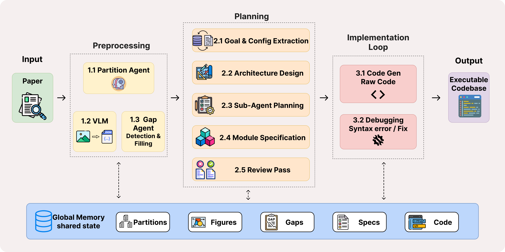

<div align="center">

# Crafter: Towards Automated Reproducible Machine Learning via Agentic Code Generation

**NeurIPS 2026**

[Project page](https://v1p0r.github.io/Crafter/) · [Paper](#) · [Quick start](#quick-start) · [Reproducing the paper](#reproducing-the-paper) · [Citation](#citation)



</div>

Crafter turns a machine learning paper into a runnable repository. It treats reproduction as **context-calibrated implementation recovery** rather than single-pass code generation: it builds an evidence-grounded specification from the paper, resolves missing implementation details *before* planning, and repairs the generated repository through execution-aware debugging.

On 23 PaperBench papers with Claude Sonnet 4.6, Crafter reaches an average Code-Dev score of **0.84**, improving over Paper2Code by 19.7% and over DeepCode by 22.1%, and it wins on 17/23 papers. In execution-oriented evaluation it is the only system to reach the contribution-level milestone on every repository, with roughly half the repair cycles of either baseline.

## Highlights

- **Implementation-gap recovery.** A dedicated Gap Agent finds five categories of implementation-critical omissions (`referenced_architecture`, `baseline_method`, `dataset_detail`, `missing_hyperparameter`, `algorithm_gap`) and resolves them from cited papers, external repositories, and dataset registries, with the target paper's official code explicitly blacklisted.
- **Figure-aware extraction.** A vision-language agent classifies figures, discards result plots, and extracts architecture diagrams into structured component/flow records that downstream planners consume as text.
- **Hierarchical planning with constraint validation.** A main planner fixes the global architecture; sub-planners produce module-level specs; a validator enforces orchestrator/module hygiene before any code is written.
- **Asymmetric-context code generation.** Modules see only their declared dependencies; orchestrators see the full module layer. Two passes, dependency order.
- **Execution-aware debugging.** A debug agent runs the repository, diagnoses root causes, and applies fixes via a multi-granularity `submit_fix` tool (line edits, file rewrites, or dependency-cascade regeneration), with snapshots and automatic rollback of regressions.

## Results

**Code-development faithfulness** (PaperBench Code-Dev, mean paper-level score in [0, 1]; *Wins* = papers on which the method scores highest of the three).

| Backend | Method | PaperBench (23) Avg. | Wins | ICLR 2026 (4) Avg. | Wins |
|---|---|---:|---:|---:|---:|
| Claude Sonnet 4.6 | Paper2Code | 0.698 | 4/23 | 0.739 | 0/4 |
| Claude Sonnet 4.6 | DeepCode | 0.684 | 2/23 | 0.683 | 0/4 |
| Claude Sonnet 4.6 | **Crafter** | **0.835** | **17/23** | **0.822** | **4/4** |
| MiniMax M2.7 | Paper2Code | 0.421 | 4/23 | — | — |
| MiniMax M2.7 | DeepCode | 0.442 | 1/23 | — | — |
| MiniMax M2.7 | **Crafter** | **0.588** | **18/23** | — | — |

**Execution-oriented evaluation** (seven repositories; M7 = execution, liveness, and contribution checks all pass).

| Method | Reached M7 | Avg. edit cycles | \|ΔLOC\| |
|---|---:|---:|---:|
| Paper2Code | 6/7 | 10.7 | 521 |
| DeepCode | 6/7 | 12.9 | 615 |
| **Crafter** | **7/7** | **5.7** | **484** |

**Ablation** (nine papers, Claude): removing debugging drops the mean Code-Dev score from 0.888 to 0.842, removing gap filling to 0.830, removing both to 0.819. Per-paper tables are in the paper's appendix.

## How it works

```
MinerU content list + figures
  │
  ├─ Stage 1   Partition          deterministic split into body / appendix / references / preamble (no LLM)
  ├─ Stage 2   Figure analysis    VLM classifies figures, extracts architecture diagrams to typed records
  ├─ Stage 2.5 Gap analysis       find + resolve missing implementation details from external evidence
  ├─ Stage 3   Planning           main planner → sub-planners → constraint validator
  ├─ Stage 4   Code generation    pass 1: modules (dependency-scoped context); pass 2: orchestrators
  ├─ Stage 4.5 Scaffolding        reproduce.sh, requirements.txt, package __init__s
  ├─ Stage 5   Debug loop         run → diagnose → submit_fix → re-run, with snapshots and rollback
  └─ Stage 6   Unit tests         optional
```

Every stage writes its state under the output directory, so re-running with the same `--output` resumes from the last cached stage.

## Installation

Python 3.10+ is required.

```bash
git clone git@github.com:v1p0r/Crafter.git
cd Crafter
python -m venv .venv && source .venv/bin/activate
pip install -r requirements.txt
```

A `Dockerfile` (CUDA 12.1, Python 3.12) is provided for running the debug loop on GPU hosts:

```bash
docker build -t crafter .
docker run --gpus all -e ANTHROPIC_API_KEY -e GEMINI_API_KEY -v $PWD/data:/app/data crafter \
  --input data/parsed/<paper> --output data/output/<paper>
```

### API keys

Crafter uses one *main* backend for planning, generation, and debugging, and Gemini for figure analysis. Backends are defined in `src/utils/llm_client.py` and selected with `LLM_BACKEND`.

| Backend (`LLM_BACKEND`) | Model | Key |
|---|---|---|
| `minimax` (default) | MiniMax-M2.7 | `ANTHROPIC_API_KEY` (Anthropic-compatible endpoint) |
| `claude` | claude-sonnet-4-6 | `CLAUDE_API_KEY_2` |
| `gpt` | gpt-4.1 | `OPENAI_API_KEY` |
| `deepseek` | deepseek-chat | `DEEPSEEK_API_KEY` |
| `gemini` | gemini-2.5-flash | `GEMINI_API_KEY` |
| figure analysis (always Gemini) | see `config/settings.yaml` | `GEMINI_API_KEY` |

Optional: `SEMANTIC_SCHOLAR_API_KEY` raises the rate limit for the gap agent's literature lookups; `BRAVE_API_KEY` enables web search in gap resolution.

## Quick start

### 1. Parse the paper

Crafter consumes the output of [MinerU](https://github.com/opendatalab/MinerU), not a raw PDF. Run MinerU on the paper and point Crafter at the directory containing the `*_content_list_v2.json` and the extracted `images/`:

```
data/parsed/<paper>/
├── <paper>_content_list_v2.json
└── images/
```

### 2. Run the pipeline

```bash
export ANTHROPIC_API_KEY=...   # MiniMax (default backend)
export GEMINI_API_KEY=...      # figure analysis

./run.sh data/parsed/<paper> \
  --output data/output/<paper> \
  --target-codebase-blacklist https://github.com/<owner>/<official-repo>
```

`--target-codebase-blacklist` prevents the gap agent from ever consulting the paper's own released code; pass it once per official repository. If omitted, repository evidence is disabled entirely rather than risk leakage.

Useful variants:

```bash
./run.sh <input> --output <out> --no-vlm        # skip figure analysis
./run.sh <input> --output <out> --skip-debug    # generate only (no GPU needed)
./run.sh --only-debug --output <out>            # resume the debug loop on an existing run
./run.sh <input> --output <out> --unit-test     # also generate unit tests
```

The Python entry point exposes everything `run.sh` does plus `--skip-gaps`, `--debug-iterations N` (default 20), and `--seed`:

```bash
LLM_BACKEND=claude python -m src.main --input data/parsed/<paper> --output data/output/<paper> --help
```

### 3. Inspect the output

```
data/output/<paper>/
├── codebase/          generated repository, including reproduce.sh and requirements.txt
├── global_memory/     partitions, figure records, gap report, architecture, module specs
└── local_memory/      per-agent prompts, reasoning, attempts, and the debug journal
```

## Reproducing the paper

The headline numbers use Claude Sonnet 4.6 as the main backend, figure analysis enabled, seed 42, and the default 20 debug iterations. Each configuration in the paper maps to a single `src.main` invocation:

```bash
export CLAUDE_API_KEY_2=...
export GEMINI_API_KEY=...
export LLM_BACKEND=claude
P=<paper>

# Crafter (full)
python -m src.main --input data/parsed/$P --output data/output/full/$P --seed 42 \
  --target-codebase-blacklist https://github.com/<owner>/<official-repo>

# w/o debug
python -m src.main --input data/parsed/$P --output data/output/no_debug/$P --seed 42 --skip-debug

# w/o gaps
python -m src.main --input data/parsed/$P --output data/output/no_gaps/$P --seed 42 --skip-gaps

# w/o gaps / debug
python -m src.main --input data/parsed/$P --output data/output/no_gaps_no_debug/$P --seed 42 --skip-gaps --skip-debug
```

Set `PTC_TOKEN_USAGE_LOG` / `PTC_TOKEN_USAGE_SUMMARY` to file paths to record per-stage token usage and cost; `run_experiment.py` does this automatically when comparing backends on one paper:

```bash
python run_experiment.py --paper $P --backends claude minimax --output-base data/experiments
```

The paper's runs were executed on a Slurm cluster in two phases: generation (stages 1–4, `--skip-debug`) for all papers via `run_claude_nothink.sh` / `run_ablation_skip_gaps.sh` / `run_paperbench_skipdebug.sh`, then the debug loop via `slurm/debug_batch_*.slurm`, which call `--only-debug` on the populated output directories. Those scripts load cluster-specific modules and virtual environments, so treat them as a record of the protocol rather than portable entry points.

Code-Dev scores were computed with the PaperBench Code-Dev grader (o4-mini judge for Claude runs, gpt-4o-mini for MiniMax runs). The execution-oriented protocol — milestone ladder M0–M7, smoke/pilot runs, liveness and contribution predicates — is described in the paper's appendix.

## Repository layout

```
src/main.py            pipeline driver and CLI
src/agents/            one agent per stage: partition, vlm, gap, planning, sub_planning, codegen, debug, unittest
src/utils/             LLM client and backends, gap evidence/matching/resolution/source discovery,
                       dataset registry, Semantic Scholar client, paper-content helpers
src/memory/            global (shared) and local (per-agent) persisted state
src/mcp/               document search, filesystem, LSP, and web-search tools exposed to agents
config/settings.yaml   model names and endpoints
tests/                 unit tests (gap agent, source discovery, debug agent, token accounting)
slurm/                 batch scripts used for the paper's runs
```

Run the tests with:

```bash
python -m unittest discover tests
```

## Citation

```bibtex
@inproceedings{crafter2026,
  title     = {Crafter: Towards Automated Reproducible Machine Learning via Agentic Code Generation},
  author    = {},
  booktitle = {Advances in Neural Information Processing Systems (NeurIPS)},
  year      = {2026}
}
```

## License

TBD.
